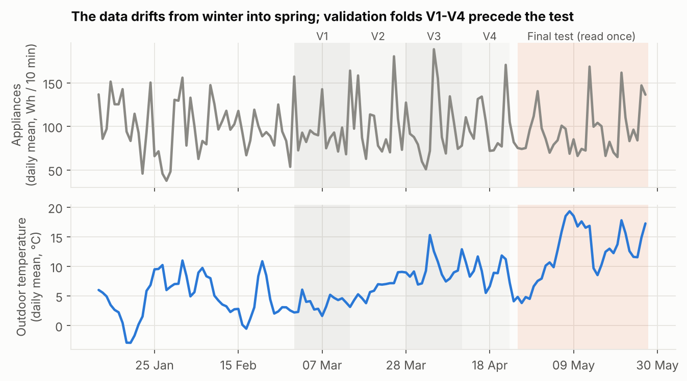
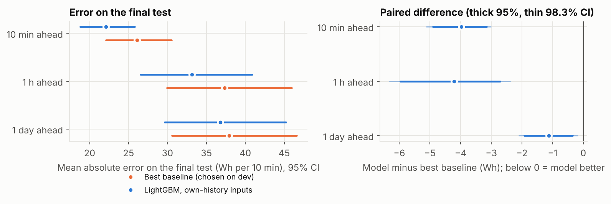
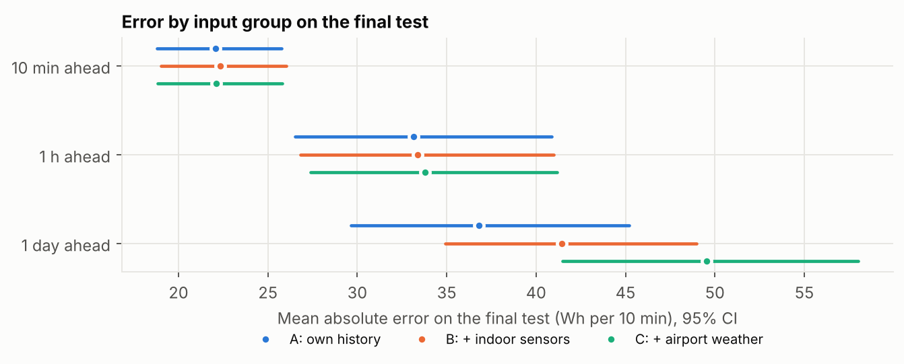
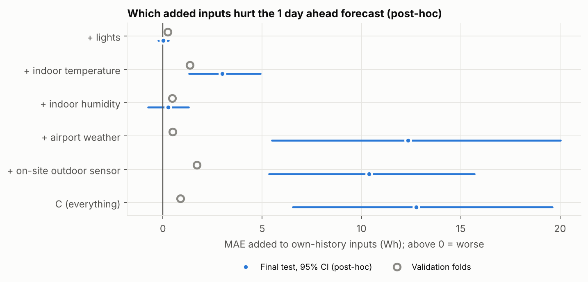
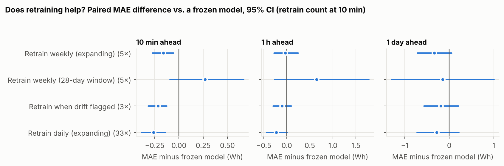
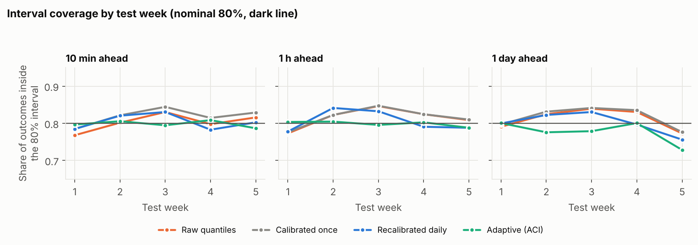
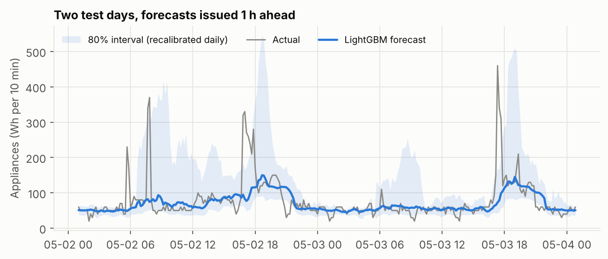
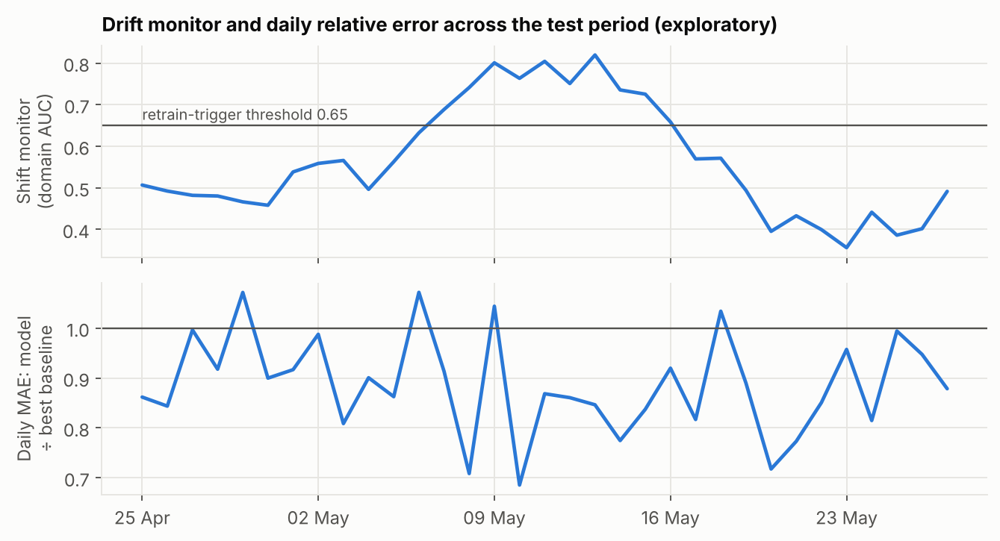

# Residential Energy Forecasting Under Changing Conditions

*A leakage-safe, pre-registered evaluation of how forecasting models, input choices, retraining and prediction intervals hold up when a house moves from winter into spring*

[Project page](https://kanishk2705.github.io/Residential-Energy-Forecasting-Under-Changing-Conditions/) · [Protocol](PROTOCOL.md) · [Data and licence](DATA.md)

> **In one paragraph.** On one house (UCI Appliances Energy data, 10-minute readings, 137 days) I froze an evaluation protocol before training anything, selected models on earlier weeks only, and then read the last 33 days exactly once. A gradient-boosted model that uses only the house's own recent consumption beat the best simple baseline by 15%, 11% and 3% at 10 minutes, 1 hour and 1 day ahead. Adding weather or indoor-sensor inputs never helped, and at one day ahead the airport-weather inputs made the forecast 34% worse once the weather left the range seen in training, a failure that validation barely hinted at. Several things I expected to matter (retraining, interval recalibration) mostly did not. This page reports the full design, the results with confidence intervals, and where the evidence is thin.

## 1. Problem

Household electricity forecasts feed demand-response schedules, battery control and anomaly alerts. A forecast that looks good in a random train/test split can still fail in use, because a real deployment predicts the **future** from the **past**, and conditions drift: it gets warmer, routines change, sensors move. The public study that released this dataset predicts the energy used *at the same moment* from simultaneous sensors, which is a regression, not a forecast.

**Research question.** When a house moves from winter into spring, which of the usual forecasting choices still hold up: (1) the model against simple baselines, (2) the input groups (own history, indoor sensors, weather), (3) the retraining policy, and (4) the calibration of prediction intervals?

**Data.** UCI *Appliances Energy Prediction*: one low-energy house in Belgium, 19,735 readings every 10 minutes from 11 Jan to 27 May 2016, target `Appliances` (Wh per 10 minutes, typically 50 to 100 with sharp spikes), 9 indoor temperature/humidity sensors, lights, and airport weather. Licence: **CC BY 4.0** (checked on the UCI page); the weather columns are third-party, so the raw file is not re-hosted here (see [DATA.md](DATA.md)).



*Figure 1. The final test (orange) starts with a cold week and then jumps to about 14 °C, well above anything in the weeks used for model selection (grey folds V1 to V4).*

## 2. Design

### The task

Forecast `Appliances` **10 minutes, 1 hour and 1 day ahead**, using only information available at the moment of forecast. Primary metric: mean absolute error (MAE, Wh per 10 minutes), because usage is spiky and MAE targets the typical value rather than chasing spikes.

### What I kept from standard practice, and what is mine

Standard concepts used: rolling-origin validation, gradient boosting, quantile intervals with conformal calibration, domain-classifier drift checks, block bootstrap. The design that ties them together is my own:

- **A forecasting reformulation with leakage control.** I found that the source file's weather columns are interpolated between hourly readings, so a value at 17:10 already encodes the 18:00 reading. Features use only the last real hourly reading. A unit test corrupts every row after the forecast time and requires the features not to change; a second test proves that test can fail.
- **A protocol written and published before any model ran**, with a one-time access ledger for the final test period.
- **One audit of four decisions under the same drift**, instead of four separate studies: model vs baseline, input groups, retraining policy, interval calibration.
- **A model-independent drift monitor** that triggers retraining (and a check of whether it tracks error).
- **A validation-versus-test comparison per input group**, to see which choices validation could not warn about.

### Splits (all chronological)

| Region | Period | Use |
|---|---|---|
| Development | 11 Jan to 22 Apr 2016 | 4 rolling-origin folds (14-day blocks from 29 Feb) for every choice |
| Embargo | 23 to 24 Apr | not used for the frozen model's training labels |
| **Final test** | **25 Apr to 27 May (33 days)** | read once, after the selection was frozen and published |

### Inputs, models, policies

- **Input sets.** A: own recent consumption and time-of-day/weekday of the target. B: A plus lights and indoor temperature/humidity. C: B plus airport weather (last real hourly reading) and the on-site outdoor sensor. N: C plus two random columns, a negative control.
- **Baselines (6).** Persistence, last-hour mean, same time yesterday, same time last week, typical value for that time of day, typical value for that time of week.
- **Learned models.** Ridge, random forest, LightGBM (small frozen grids, selected on the four development folds only).
- **Retraining policies.** P0 frozen; P1 retrain weekly; P2 weekly on a 28-day window; P3 retrain when the drift monitor flags (threshold 0.65, at least 3 days apart); P4 retrain daily.
- **Intervals (80%).** I0 raw quantiles; I1 calibrated once; I2 recalibrated daily; I3 adaptive conformal (ACI).
- **Statistics.** Day-block bootstrap (5,000 resamples), 95% CIs, all differences paired; the three headline comparisons also with a Bonferroni-adjusted CI. A difference is called supported only if its CI excludes zero.

What development selected: **LightGBM on own-history inputs (set A) at every horizon**. Negative controls passed: the two random columns received at most 1.0% of model importance (about 3.4% if they mattered as much as any other input), and a model trained on time-block-shuffled targets was never better than the baseline (error ratio 1.02 to 1.19).

## 3. Implementation

- Python 3, pandas, scikit-learn, LightGBM; about 2,200 lines of Python across `src/energyshift/` and `scripts/`; **43 automated tests** (leakage, split boundaries, label availability, bootstrap coverage, interval and policy logic).
- `PROTOCOL.md` was committed and pushed before any model was trained (branch [`frozen/protocol`](https://github.com/kanishk2705/Residential-Energy-Forecasting-Under-Changing-Conditions/tree/frozen/protocol), commit `8d2bbb1`). The selection was frozen on [`frozen/selection`](https://github.com/kanishk2705/Residential-Energy-Forecasting-Under-Changing-Conditions/tree/frozen/selection) (commit `6dc9712`) before the test period was read; the ledger `results/final/test_access.json` records that commit, the protocol hash and the data hash.
- Three deviations from the protocol, all logged with reasons in `PROTOCOL.md` (see the audit trail below).
- The 1-hour and 1-day models use no weather forecast, only past observations, which is what a deployed system without a forecast feed would have.

```
pip install -r requirements.txt
python scripts/get_data.py            # fetch + checksum (the UCI route was blocked in my sandbox; see DATA.md)
python -m pytest -q
python scripts/run_dev.py             # development grid and selection (about 1 h on 2 cores)
# commit results/dev/selection.json on a branch named frozen/selection, then:
python scripts/run_final.py           # reads the test period exactly once
python scripts/diagnostics.py         # post-hoc, exploratory
python scripts/make_figures.py && python scripts/make_report.py
```

## 4. Results

### 4.1 Do learned models beat simple baselines?

| Horizon | Best baseline (chosen on dev) | Baseline MAE | LightGBM MAE | Difference in MAE, Wh (95% CI) | Relative gain (95% CI) |
|---|---|---|---|---|---|
| 10 min | persistence (last value) | 26.1 | 22.1 | −3.98 (−4.90 to −3.15) | 15% (14% to 17%) |
| 1 h | typical value for that time of day | 37.3 | 33.1 | −4.21 (−5.96 to −2.72) | 11% (8% to 15%) |
| 1 day | typical value for that time of day | 37.9 | 36.8 | −1.13 (−1.93 to −0.35) | 3% (1% to 5%) |

*MAE in Wh per 10 minutes on the 33-day final test. Differences are paired over the same days.*

Yes, at every horizon, and the gain shrinks as the horizon grows: a day ahead the model is only 3% better than the typical value for that time of day. Each method's own CI is wide because some days are much busier than others; the paired difference is the proper comparison.



*Figure 2. Left: error of each method with its 95% CI. Right: paired difference (thick 95%, thin Bonferroni-adjusted 98.3%).*

### 4.2 Do extra inputs help?

| Horizon | A: own history | B: + indoor | C: + weather | B − A (95% CI) | C − A (95% CI) |
|---|---|---|---|---|---|
| 10 min | 22.1 | 22.3 | 22.1 | +0.26 (+0.11 to +0.42) | +0.04 (−0.10 to +0.17) |
| 1 h | 33.1 | 33.4 | 33.8 | +0.23 (−0.20 to +0.66) | +0.64 (−0.07 to +1.28) |
| 1 day | 36.8 | 41.4 | 49.6 | +4.65 (+2.43 to +7.25) | +12.76 (+6.54 to +19.61) |

*MAE (Wh) on the final test with LightGBM and the same hyper-parameters.*

No. At 10 minutes and 1 hour the extra inputs change little. **At one day ahead they hurt a lot**: weather inputs add 12.8 Wh of error. Development had warned of only +0.9 Wh. A post-hoc breakdown (it uses test outcomes, so it explains and does not select) points at the airport-weather group (+12.3 Wh on test, +0.5 in validation) and the on-site outdoor sensor (+10.4 vs +1.7), the inputs whose values moved furthest from what the model had seen: the mean outdoor temperature over the previous 24 hours averaged 5.9 °C in development and 12.0 °C in the test. This fits tree models that cannot extrapolate beyond training values; I did not test that mechanism.



*Figure 3. Error by input group on the final test, 95% CIs.*



*Figure 4 (post-hoc). Extra error from adding each input group to own-history inputs at one day ahead. Hollow circles: validation folds. Dots with bars: final test.*

### 4.3 Does retraining help?

| Policy | Retrains (10 min / 1 h / 1 day) | 10 min: Δ MAE vs frozen | 1 h: Δ MAE | 1 day: Δ MAE |
|---|---|---|---|---|
| P0 frozen | 0 / 0 / 0 | baseline | baseline | baseline |
| P1 weekly | 5 / 5 / 5 | −0.16 (−0.27 to −0.06) | −0.03 (−0.28 to +0.24) | −0.34 (−0.72 to +0.05) |
| P2 weekly, 28-day window | 5 / 5 / 5 | +0.27 (−0.09 to +0.67) | +0.65 (−0.27 to +1.78) | −0.15 (−1.29 to +1.00) |
| P3 drift-triggered | 3 / 4 / 3 | −0.22 (−0.32 to −0.13) | −0.11 (−0.30 to +0.10) | −0.19 (−0.57 to +0.21) |
| P4 daily | 33 / 33 / 33 | −0.26 (−0.39 to −0.14) | −0.22 (−0.44 to +0.01) | −0.28 (−0.73 to +0.22) |

*Paired difference in MAE (Wh) relative to the frozen model, 95% CI. Negative = better than frozen.*

Only at 10 minutes did retraining help in a supported way, by about 0.7% to 1.2% of the error. The drift-triggered policy retrained 3 times and achieved −0.22 Wh, against −0.26 Wh for 33 daily retrains. I did not pre-specify a direct test between those two, so read that as similar point estimates, not as proof. At 1 hour and 1 day no policy has a CI that excludes zero. Throwing away data older than 28 days never helped (the CI for 1 hour spans zero and its point estimate is worse).



*Figure 5. Each row is a retraining policy; the dot is the paired MAE difference versus the frozen model, bars are 95% CIs.*

### 4.4 Are the prediction intervals calibrated?

| Variant | 10 min: coverage (95% CI) | 1 h: coverage | 1 day: coverage | Mean width, Wh (10 min / 1 h / 1 day) |
|---|---|---|---|---|
| I0 raw quantiles | 80% (79% to 82%) | 82% (79% to 84%) | 82% (79% to 84%) | 73 / 121 / 135 |
| I1 calibrated once | 82% (80% to 83%) | 82% (80% to 84%) | 82% (79% to 84%) | 74 / 121 / 136 |
| I2 recalibrated daily | 80% (79% to 82%) | 81% (78% to 83%) | 81% (78% to 83%) | 74 / 120 / 135 |
| I3 adaptive (ACI) | 80% (79% to 81%) | 80% (78% to 81%) | 78% (74% to 82%) | 73 / 120 / 163 |

*Nominal coverage is 80%. Width in Wh per 10 minutes.*

My pre-registered expectation, that raw intervals would under-cover under drift, **was not borne out**: raw quantile intervals covered 80% to 82% of outcomes and every CI contains 0.80. The first test week, which was the cold one, was the weakest (raw coverage 77% at 10 minutes). Recalibration made little difference. At one day ahead the adaptive variant was worse (78% coverage with intervals about 21% wider); I did not diagnose why. One candidate is that outcomes arrive a full day late at that horizon, but I did not test that.



*Figure 6. Share of outcomes inside the 80% interval, by test week.*



*Figure 7. Two test days at 1 hour ahead: spikes are the main source of error and the interval widens around them.*

### 4.5 What did the drift look like, and did the monitor see it?

| Test week | Dates | Mean outdoor °C | Mean usage (Wh) | Shift vs last 4 dev weeks (AUC) | MAE baseline | MAE model | Raw interval coverage |
|---|---|---|---|---|---|---|---|
| 1 | 04-25 to 05-01 | 5.7 | 96 | 0.56 | 40.8 | 38.2 | 77% |
| 2 | 05-02 to 05-08 | 13.9 | 84 | 0.79 | 29.6 | 26.7 | 82% |
| 3 | 05-09 to 05-15 | 14.9 | 96 | 0.58 | 36.4 | 30.8 | 85% |
| 4 | 05-16 to 05-22 | 13.6 | 94 | 0.46 | 36.2 | 30.2 | 82% |
| 5 | 05-23 to 05-27 | 13.3 | 108 | 0.67 | 46.8 | 42.8 | 81% |

*1-hour-ahead horizon. Mean outdoor temperature over the last 28 development days: 9.4 °C; mean usage 99 Wh.*

The shift was a step, not a slow drift: a cold first week (5.7 °C) followed by weeks near 14 °C. The drift monitor (a classifier asking whether the last 7 days of the model's inputs look different from the 28 days before) crossed the 0.65 trigger from 05-07 to 05-16. For the selected model those inputs are its own recent consumption, so the monitor does not see temperature at all. Across test days the monitor was unrelated to daily relative error (Spearman −0.16, 95% CI −0.52 to 0.23; exploratory). Late-May values fell below 0.5, which a proper two-class AUC should not do systematically; I attribute this to a small-sample cross-validation artifact (it cannot trigger a retrain, since triggers need high values) but did not verify that.



*Figure 8. Top: drift monitor (1 h horizon). Bottom: daily model error relative to the best baseline.*

### 4.6 Expectations written before the test, and what happened

| Pre-registered expectation | Outcome |
|---|---|
| H1: models beat the best baseline at 1 h and 1 day, but not clearly at 10 min. | Partly wrong: they beat it at all three horizons, including 10 min (15% gain). |
| H2: weather inputs do not help much once own history is present. | Right, and understated: no help at 10 min or 1 h, and a large loss at 1 day (+12.8 Wh). |
| H3: periodic retraining helps modestly; daily adds little over weekly. | Only supported at 10 min (about 1%); no supported effect at 1 h or 1 day. Daily vs weekly was not tested directly. |
| H4: raw intervals under-cover under drift; recalibration moves coverage toward 80%. | Wrong. Raw intervals were already near 80%; ACI was worse at 1 day. |

*From PROTOCOL.md section 11; none of these were commitments.*

## 5. Limitations

- **One house, one 4.5-month episode, 33 test days.** The CIs describe sampling noise in this house and period. Nothing here shows the same ranking would hold in another house or season.
- **The shift is a temperature step in spring.** Other changes (a new appliance, occupancy) are not covered.
- **Weather inputs are past observations, not forecasts.** A system with a weather-forecast feed might behave differently.
- **No holiday calendar.** The test period probably includes public holidays the model does not know about.
- **Timestamp convention unknown.** Whether a row covers the 10 minutes before or after its timestamp is undocumented; every feature and target is indexed by row, so the design holds either way.
- **Post-hoc parts are explanation only.** The input-group breakdown and input-range figures were run after the test was read and are labelled as such. The mechanism (no extrapolation outside training range) is a hypothesis.
- **The drift monitor is noisy** (see 4.5) and its link to error was not supported. Its threshold (0.65) was fixed before the test, not tuned.
- **Small frozen hyper-parameter grids** (3 families, 9 configurations); heavier tuning might change margins.
- **Spikes dominate error.** MAE and 80% intervals say little about the rare large spikes that matter most for peak management.

## 6. Next steps

- Repeat the audit on a second house or dataset to test whether the input-group finding transfers.
- Add an **input-range guard**: when inputs leave the training range, fall back to the own-history model. This follows directly from the day-ahead failure.
- Replace past weather observations with weather forecasts and see whether the loss disappears.
- Diagnose why adaptive interval calibration worsened at one day ahead (delayed feedback is one candidate).
- Add a holiday calendar and a spike-oriented probabilistic model.

## 7. Audit trail

- **D1 (administrative).** The sandbox could not push git tags, so freeze markers are pinned branches (`frozen/protocol`, `frozen/selection`).
- **D2.** A dry run on development data showed the drift statistic's windows overlapped after retrains, producing artifact AUCs as low as 0.17. Before any test read, I changed the windows to "last 7 days vs the 28 days before" (details and numbers in `PROTOCOL.md`).
- **D3.** Three code bugs found by synthetic smoke runs and fixed with tests; implementation choices that the protocol left open are listed in `PROTOCOL.md`.
- The final test was read once (ledger: commit `6dc9712`, data SHA-256 `2820bf712ad0…`). Post-hoc diagnostics were run after it and are marked as such.

## Data, licence and citation

Code: MIT. Data: UCI Appliances Energy Prediction, CC BY 4.0, not redistributed here ([DATA.md](DATA.md)). Please cite: Candanedo, L. (2017), UCI Machine Learning Repository, https://doi.org/10.24432/C5VC8G; and Candanedo, Feldheim, Deramaix (2017), *Energy and Buildings* 140, 81-97, https://doi.org/10.1016/j.enbuild.2017.01.083.
